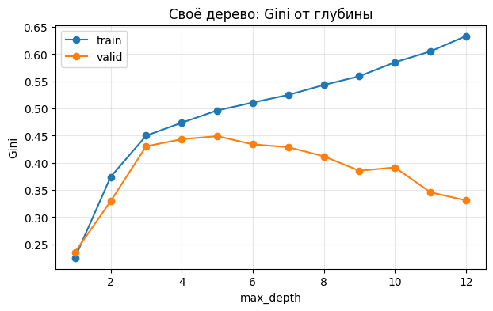

# Деревья решений и ансамбли с нуля

Дерево решений, Random Forest, Extra Trees и градиентный бустинг, написанные с нуля на NumPy и сверенные со `scikit-learn`. Задача: по данным о машине, купленной на автоаукционе, предсказать, окажется ли она «лимоном», то есть машиной со скрытыми проблемами. В конце те же данные решаются LightGBM, XGBoost и CatBoost.

Это продолжение проекта [lemon-cars-classification](https://github.com/idanrus/lemon-cars-classification), где та же задача решалась логистической регрессией (test Gini 0.487).

## Данные

[Don't Get Kicked! (Kaggle)](https://www.kaggle.com/competitions/DontGetKicked/data): около 73 тыс. машин, купленных на аукционах в 2009-2010 годах.

- **Таргет:** `IsBadBuy`, «лимонов» около 12%.
- **Разбиение по дате покупки:** первая треть в train, вторая в valid, последняя в test. Пропуски и one-hot считаются только по train, test используется один раз в конце.
- **Метрика:** Gini = 2 * ROC AUC - 1.

## Что сделано

- **Своё дерево решений** (`trees.py`): классификатор по Gini impurity и регрессор по MSE. Пороги ищутся за один проход по отсортированному признаку через накопленные суммы.
- **Extra Tree:** случайные пороги вместо полного перебора.
- **Random Forest и Extra Trees:** бутстрэп строк и случайные признаки в каждом узле, фиксированный seed.
- **Градиентный бустинг** на логлоссе: старт с логарифма шансов, каждое дерево учится на антиградиенте `y - p`, есть `subsample` и `max_features`.
- **LightGBM, XGBoost (в том числе DART), CatBoost:** ранняя остановка по valid и небольшой перебор параметров. CatBoost обучен на исходных категориях и, для сравнения, на one-hot.

## Результаты

Разбиение по дате: train, valid и test примерно по 24 тыс. машин, признаков после one-hot 265.

| Модель | train Gini | valid Gini | test Gini |
|---|---|---|---|
| **XGBoost (лучшая на valid)** | **0.613** | **0.497** | **0.506** |
| CatBoost (исходные категории) | 0.631 | 0.493 | 0.503 |
| LightGBM | 0.625 | 0.490 | 0.508 |
| GradientBoosting (sklearn) | 0.572 | 0.487 | 0.499 |
| GBDT (свой) | 0.503 | 0.476 | 0.486 |
| Extra Trees (свой) | 0.555 | 0.470 | 0.494 |
| Random Forest (свой) | 0.568 | 0.466 | 0.487 |
| Random Forest (sklearn) | 0.573 | 0.467 | 0.483 |
| Дерево решений (своё, глубина 5) | 0.496 | 0.449 | 0.456 |
| Дерево решений (sklearn, глубина 5) | 0.496 | 0.450 | 0.463 |

Для сравнения: логистическая регрессия из прошлого проекта дала test Gini 0.487.



## Выводы

- Лучшая модель XGBoost с неглубокими деревьями и ранней остановкой: test Gini 0.506. Это на 0.02 лучше логистической регрессии. Прирост небольшой, потому что почти весь сигнал в нескольких признаках.
- LightGBM, XGBoost и CatBoost отличаются меньше чем на 0.01, порядок на valid и test разный. Исходные категории в CatBoost по сравнению с one-hot ничего не дали.
- Ансамбли заметно лучше одного дерева. Одно дерево начинает переобучаться уже с глубины 6: Gini на train растёт, на valid падает.
- Свои реализации совпадают со sklearn: дерево почти один в один, лес и Extra Trees в пределах 0.002 на valid. Свой бустинг слабее на 0.01, потому что в листе среднее антиградиента, а не шаг Ньютона. Медленнее sklearn в 7-60 раз.
- Просадки на test нет. Самый важный признак: пропуск в типе колёс, дальше возраст машины.

## Как запустить

```bash
pip install -r requirements.txt
```

Скачайте `training.csv` с Kaggle в папку `data/` и откройте `tree_ensembles.ipynb`. Модели лежат в `trees.py`.

**Стек:** Python, NumPy, pandas, scikit-learn, LightGBM, XGBoost, CatBoost, matplotlib.
